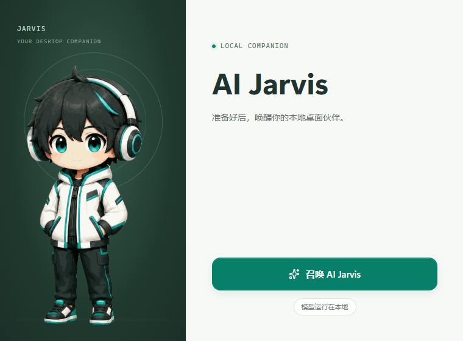
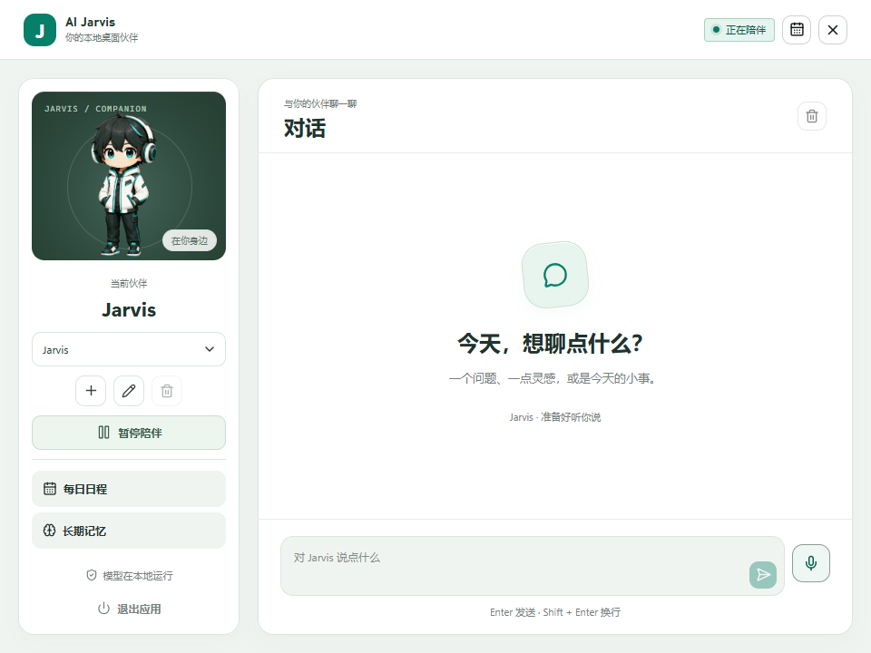
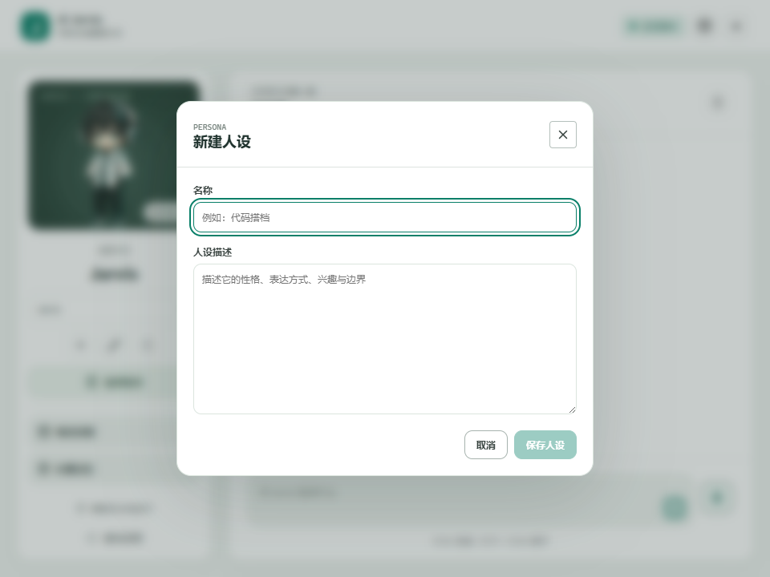

# AI Jarvis

**住在桌面上的本地 AI 伙伴。**

AI Jarvis 是一款面向 Windows 的桌面陪伴应用。它把文字与语音对话、屏幕观察、游戏弹幕、课程笔记和长期记忆放在同一个桌宠体验里，使用本机运行的 Qwen 与 SenseVoice 模型。

<p align="center">
  
</p>

<p align="center">Windows x64 · Tauri 2 · React 19 · Rust · 本地推理</p>

## 可以做什么

- **与你交流**：在控制台或桌宠旁输入消息，也可通过麦克风进行语音输入。
- **跟随当前活动**：结合屏幕、系统音频与活动状态判断何时回应，减少不必要的打扰。
- **陪你游戏与学习**：游戏场景使用桌面弹幕；课程场景支持会话确认与课程笔记。
- **回顾一天**：从本地观察记录生成日程总结，并展示精选截图。
- **记住明确表达的信息**：提炼偏好、事实和任务背景，支持编辑、删除及停用长期记忆。
- **定制伙伴**：创建、切换和编辑人设；可以随时暂停陪伴，或从托盘退出应用。

当前版本为 `0.1.0`，仍在积极开发。模型表现、推理速度及屏幕/音频捕获兼容性取决于实际环境。

## 界面与桌宠

### 控制台

独立的伙伴卡片、对话区和输入区，让常用操作随手可达。



### 自定义人设



### 陪伴的不同状态

<table>
  <tr>
    <td align="center"><br />待机</td>
    <td align="center"><br />交流</td>
    <td align="center"><br />学习</td>
    <td align="center"><br />休息</td>
  </tr>
</table>

界面图片由项目的真实前端组件渲染；控制台使用空会话及演示运行状态，不是模型推理结果。桌宠图片直接引用应用打包使用的资源。

## 从源码运行

### 环境要求

- Windows 10 1903 或更新版本，**x86_64** 架构；当前不支持 macOS、Linux 或 Windows ARM 原生构建。
- Node.js 24 LTS，以及项目指定的 pnpm `11.19.0`。
- 当前稳定版 Rust，目标为 `x86_64-pc-windows-msvc`。
- Visual Studio Build Tools 的「使用 C++ 的桌面开发」组件及 Windows SDK。
- Microsoft Edge WebView2 Runtime；PowerShell 7 用于下方的 `pwsh` 命令。
- 与配置一致的 llama.cpp，以及 Qwen / SenseVoice 模型。

模型文件合计约 3.83 GB；还需为 Rust 编译缓存、运行库及本地记录预留额外空间。推理耗时因 CPU、GPU、内存和 llama.cpp 后端而异。

### 安装依赖与模型

在项目根目录打开 PowerShell：

```powershell
pnpm install --frozen-lockfile
pnpm prepare:asr
```

`prepare:asr` 编译语音识别子程序并准备需要的 DLL；首次执行可能较慢。

本项目固定模型版本、文件大小和 SHA-256，配置位于 [resources/config/model.toml](resources/config/model.toml)。准备以下模型及推理程序：

| 组件 | 用途 | 固定配置 |
| --- | --- | --- |
| Qwen3.5-4B GGUF | 对话、视觉理解、总结 | `UD-Q4_K_XL`，配套 `mmproj-BF16.gguf` |
| SenseVoice ONNX | 语音转文字 | `model.int8.onnx` 与配套 `tokens.txt` |
| llama.cpp | Qwen 本地推理服务 | build `10752`，提交 `b96806d96061049a5b574269b049bf6241d63d46` |

将配置匹配的 llama.cpp 安装好后，确认 `llama.exe` 可被找到。也可以显式指定路径：

```powershell
$env:AI_JARVIS_LLAMA_EXE = "C:\path\to\llama.exe"
```

下载模型并检查环境：

```powershell
pwsh -NoProfile -File scripts/download-models.ps1
pwsh -NoProfile -File scripts/setup.ps1
```

模型默认存放在 `%LOCALAPPDATA%\AIJarvis\models`。需要更换目录时，在下载与启动前设置：

```powershell
$env:AI_JARVIS_MODEL_DIR = "D:\AIJarvisModels"
```

下载优先使用配置内的镜像源，失败后回退到官方源。首次在启动页点击「召唤 AI Jarvis」也会检查并下载缺失模型；llama.cpp 仍需预先准备，随意替换版本可能无法通过完整性检查。

### 启动与构建

```powershell
# 启动开发模式，自动准备语音识别子程序并运行 Vite
pnpm tauri dev

# 编译可直接用于本地验证的 Windows 调试程序，不生成安装包
pnpm tauri build --debug --no-bundle
```

调试程序输出到 `src-tauri/target/debug/ai-jarvis.exe`。它依赖旁边的运行库及资源文件，分发时不能只复制一个 exe。需要构建安装包时使用 `pnpm tauri build`。

只查看前端布局可以运行 `pnpm dev`，并访问终端显示的地址。浏览器模式没有原生 IPC，无法执行模型、录音或窗口操作。

## 隐私与本地数据

推理服务绑定本机 `127.0.0.1`。日常推理不需要云端模型 API Key；初次下载依赖与模型需要联网。

屏幕观察、系统音频和麦克风输入涉及你的实际桌面内容。**暂停陪伴会停止感知及相关任务，但不会自动删除已保存的记录。** 长期记忆、聊天历史、课程笔记以及日程截图会保存在本机；本地运行不等于不落盘。

应用配置目录通常为 `%APPDATA%\com.aijarvis.desktop`，其中包括：

| 文件 / 目录 | 内容 |
| --- | --- |
| `settings.json`、`startup-state.json` | 运行设置与启动状态 |
| `personas.json` | 自定义人设 |
| `chat-history.json` | 对话历史 |
| `memories.json` | 长期记忆 |
| `course-sessions/` | 课程会话记录与笔记 |
| `daily-schedule/` | 日程截图缓存及总结 |

可以在界面中清空对话、管理记忆和删除日程总结。调试构建还会生成诊断日志；启动前设置 `$env:AI_JARVIS_DEV_LOG = "0"` 可关闭该日志，发布构建不包含此调试日志模块。分享问题报告时请先检查附件是否包含私人内容。

## 项目结构

```text
src/
  components/          聊天输入、气泡、桌宠等共享组件
  hooks/               会话与活动状态
  lib/                 IPC、类型、资源加载和弹幕调度
  windows/             启动页、控制台、桌宠、弹幕窗口
src-tauri/src/
  conversation/        对话、人设、记忆、课程笔记和日程
  desktop/             IPC 命令、窗口、托盘与弹幕集成
  perception_runtime/  活动、屏幕采集与观察处理
  runtime/             启动、模型服务、隐私、调度和设置
  voice/               音频采集、语音识别及子程序协议
  bin/                 语音识别子程序入口
  lib.rs               应用组装与入口注册
src-tauri/tests/       Rust 集成与模型契约测试
resources/            固定模型配置、提示词和 JSON Schema
assets/pet/           桌宠原始素材
assets/screenshots/   项目展示图片
public/assets/pet/    应用打包使用的桌宠素材
scripts/              环境检查、模型下载与构建辅助
```

Rust 根模块保留公开导出，以兼容现有集成测试和子程序。前端原生调用集中在 `src/lib/ipc.ts`。

## 测试与贡献

```powershell
pnpm test
pnpm build
pwsh -NoProfile -File scripts/tests/Setup.Tests.ps1
cargo test --manifest-path src-tauri/Cargo.toml
cargo fmt --manifest-path src-tauri/Cargo.toml --check
cargo clippy --manifest-path src-tauri/Cargo.toml --all-targets -- -D warnings
```

真实模型契约测试默认忽略。安装固定模型后，可单独运行 Qwen 测试；SenseVoice 还需要 [音频夹具说明](src-tauri/tests/fixtures/audio/README.md) 中指定的合法 PCM WAV 录音：

```powershell
cargo test --manifest-path src-tauri/Cargo.toml --test model_contract -- --ignored --test-threads=1
cargo test --manifest-path src-tauri/Cargo.toml --test asr_contract -- --ignored --test-threads=1
```

单元测试通过不代表真实设备、真实录音和模型契约已经验证，不能用模拟转写替代这些检查。

欢迎提交问题和 Pull Request。报告问题时请附上 Windows 版本、模型配置、复现步骤与经过检查的日志；功能变更先写测试，界面变更附截图。请勿提交模型、录音、生成二进制或编译缓存。
